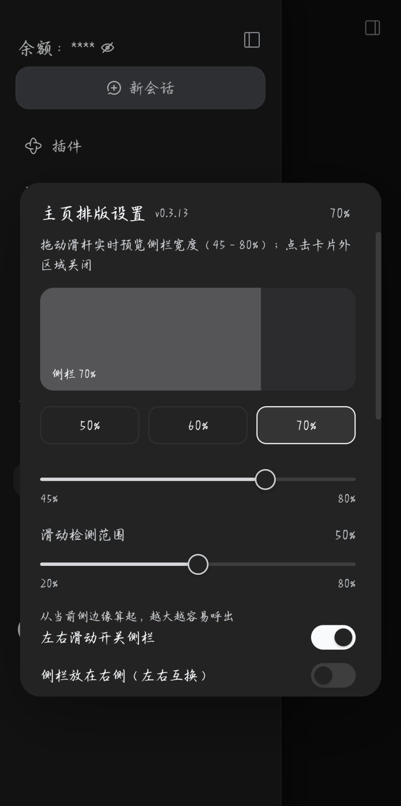
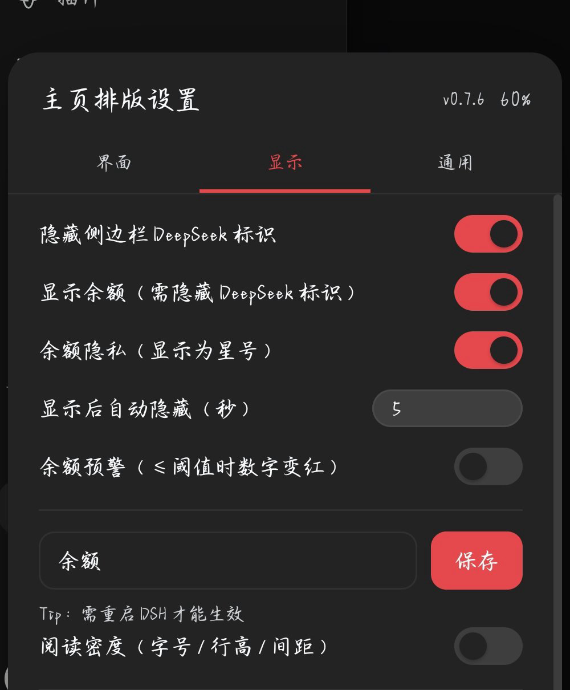
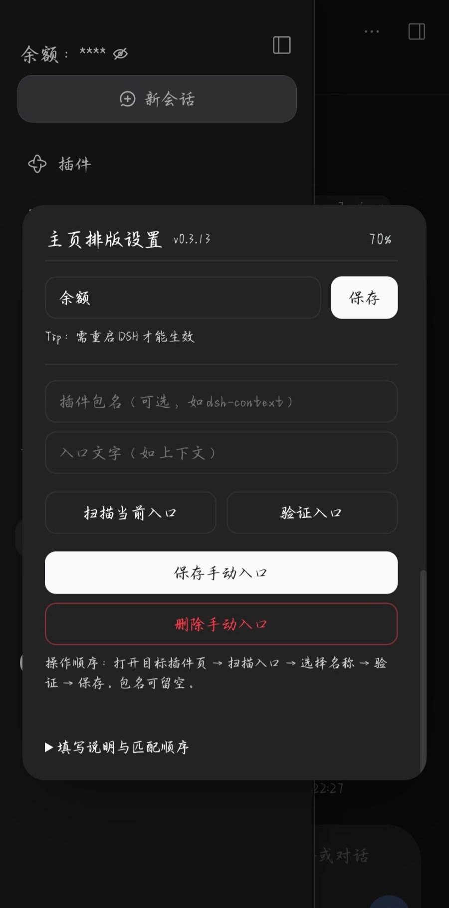

[中文](README.zh.md) | English

[](https://github.com/yinfenAce/dsh-sidebar-optimization/actions/workflows/ci.yml)
# 侧边栏优化 · dsh-sidebar-optimization

 · **v0.3.18** · [Changelog](CHANGELOG.md)

Sidebar optimization for [DSHBox](https://github.com/WSK-build/DSHBox) / DeepSeek Harness (DSH).

A small, client-only layer on top of the bundled `@local/dsh-mobile-adapt` plugin. It does not replace
that plugin; it only overrides a few mobile-specific styles and adds a couple of interactions.

## Screenshot



*Real device screenshot (v0.3.13; v0.3.14 adds balance refresh and auto-remask).*



*Balance privacy and low-balance warning.*



*Manual usage entry.*

> The screenshots were captured on **v0.3.13**. Later releases add features and a tabbed layout, so the images are kept temporarily. The current UI uses three top tabs — Interface, Display, General — and the width can now reach 100%.

## What it does

- **Adjustable half-screen sidebar** — default 60% of the viewport. Open the sidebar and tap **「主页排版设置」** above Settings; a card opens with a live preview, 50% / 60% / 70% / 100% presets and a custom 45%–100% slider. The choice is remembered.
- **Tap the blank area to close** — the backdrop is forced visible (the bundled plugin hides it with an
  inline `display:none`), so tapping the right-hand blank strip closes the drawer.
- **Free single scroll** — panels, the session list and the footer scroll as one column, instead of the
  session list scrolling inside a squeezed box.
- **Sticky footer** — settings/footer stay reachable while browsing a long session list.
- **Long-chat performance** — `content-visibility: auto` on chat turns; off-screen messages are skipped
  during the reflow caused by the on-screen keyboard.
- **Keyboard follow** — `visualViewport` resizes the root immediately when the keyboard opens/closes,
  instead of waiting for `100dvh` to be recalculated.
- **Adjustable swipe zone** — 20–80% of the screen from the active edge, with a flashing light-blue guide while you adjust it; the guide stays under the settings card.
- **Swipe gestures (experimental)** — swipe right from the left third of the screen (chat, plugins, task board or any other page) to open; swipe left to close. If it does not trigger on your device, the ☰ button still works; it can be turned off in the settings card.
- **Session tap closes the drawer** — after selecting a session, the drawer collapses automatically
  (unless DSH already closed it).
- **Open reveals the active session** — opening the drawer scrolls the current session into view.
- **Balance quick actions** — tap the amount to open 「查看用量 / 充值」; usage checks installed + enabled third-party usage/context plugins and falls back to the platform usage page, top-up opens the DeepSeek platform.
- **Live account balance (optional)** — refreshed whenever the drawer opens, formatted to two decimals. It is shown only when the DeepSeek mark is hidden; with the mark hidden and balance off, nothing is shown. A 2–4 character custom label can be saved in the card (restart DSH to apply).
- **Balance privacy** — masks the amount as `****` with an eye-slash button; the eye reveals it temporarily, and closing the drawer or switching apps re-masks it.
- **Low-balance warning** — optional threshold (default ¥1); the amount turns red at or below it. The balance menu also has a manual refresh action. Presets 1 / 5 / 10 are available.
- **Auto-hide countdown** — when privacy is on, the revealed amount returns to `****` after a configurable 5–600 seconds (default 30).
- **Settings backup** — copy the plugin's settings as JSON, restore from pasted text, or reset only the plugin's own keys; the page reloads after restore/reset.
- **Left/right layout swap** — move the sidebar to the right and the right panel to the left; the swipe direction reverses with it (right third, swipe left to open).
- **Draggable ☰ button** — long-press the ☰ and drag it; on release it snaps to the nearest side, and the position is remembered.
- **Hide the DeepSeek brand mark** — optional toggle in the settings card; the collapse control stays in place.
- **Tabbed settings card** — top tabs for Interface, Display and General; the Interface tab is selected by default; tapping another tab switches the panel.
- **Scrollable settings card** — the card stays centered; its content scrolls when the viewport is short.
- **No blue focus ring on tap** — touch interactions no longer leave a square focus outline; keyboard focus rings are preserved.
- **Copy that actually works** — a textarea/`execCommand` fallback backs the Clipboard API, and every code block gets a visible “复制” button.
- **View-switch transition** — switching the top view/trajectory tab fades and lifts the new content in instead of snapping.
- **Touch polish** — 42px panel rows, vertical-only panning inside the drawer, safe-area bottom padding.

## Adapting another usage plugin

The balance menu looks for an enabled bundle whose id/name matches `context`, `usage`, `token-usage` or `token-meter`, then opens that plugin's **feature entry** (the sidebar item or conversation-view tab whose text matches the plugin's title). It does not open the bundle's configuration page.

To add a plugin that is not auto-detected, either fill the manual entry form (package name + sidebar/tab label; use 「扫描当前入口」 and 「验证入口」) in the settings card, or add its bundle id and a short navigation label to `USAGE_BUNDLES` in `lib/client.js`. If the plugin has no feature entry (only a settings page), the usage action falls back to `https://platform.deepseek.com/usage`.

## Compatibility

- **DSHBox**: designed for **1.4+ / 1.5.x** with the bundled `@local/dsh-mobile-adapt` plugin enabled; tested on **1.5.1**.
- **DSH**: declared `>=0.2.0-rc.2 <0.3.0` (`0.2.x`); tested on **0.2.1-rc.5**. 0.2.0 and 0.2.2 are expected to work.
- **Android**: **10+** with a current WebView; tested on **Android 14** (system WebView).
- **Viewport**: ≤ 1024px (phone/tablet). Desktop layouts are untouched.

The tweaks target the generic sidebar classes (`sidebarCol`, `logoRow`, `footArea`, `viewArea`, `data-chat-turn`), so other combinations are expected to work. They are not individually tested; if a DSHBox update changes the drawer DOM, some rules may stop applying — open an issue with your version and a screenshot.

## Install

From npm (once published):

```sh
dsh plugin --profile web add dsh-sidebar-optimization
```

From source:

```sh
dsh plugin --profile web add github:yinfenAce/dsh-sidebar-optimization
```

Then restart DSH (or reload the DSH page) so the client bundle is served.

> Historical releases are hidden from the public release page. Install the latest release or `main`; do not use older tarballs.

## Install a pinned version

Every release also attaches an npm-format tarball, so you can install an exact version without publishing to npm:

```sh
dsh plugin --profile web add https://github.com/yinfenAce/dsh-sidebar-optimization/releases/download/v0.3.18/dsh-sidebar-optimization-0.3.18.tgz
```

## Turn it off

The tweaks follow the **Mobile adaptation** switch in DSHBox: when `@local/dsh-mobile-adapt` is turned
off, this plugin's style is disabled too.

To remove the plugin:

```sh
dsh plugin --profile web remove dsh-sidebar-optimization
```

## Caveats

- This is an **overlay on the bundled plugin's DOM/CSS**. A DSHBox update that changes
  `dsh-mobile-adapt`'s class names or drawer structure can break parts of it.
- Only mobile widths are affected; the desktop layout is deliberately left alone.
- No background services, no data collection, no network calls.

## Development

- [Architecture](docs/ARCHITECTURE.md)
- [Development and release flow](docs/DEVELOPMENT.md)
- [Contributing](CONTRIBUTING.md)
- [Security policy](SECURITY.md)

```sh
npm run check
npm test
npm pack --dry-run
```

## License

MIT. See [LICENSE](LICENSE).
