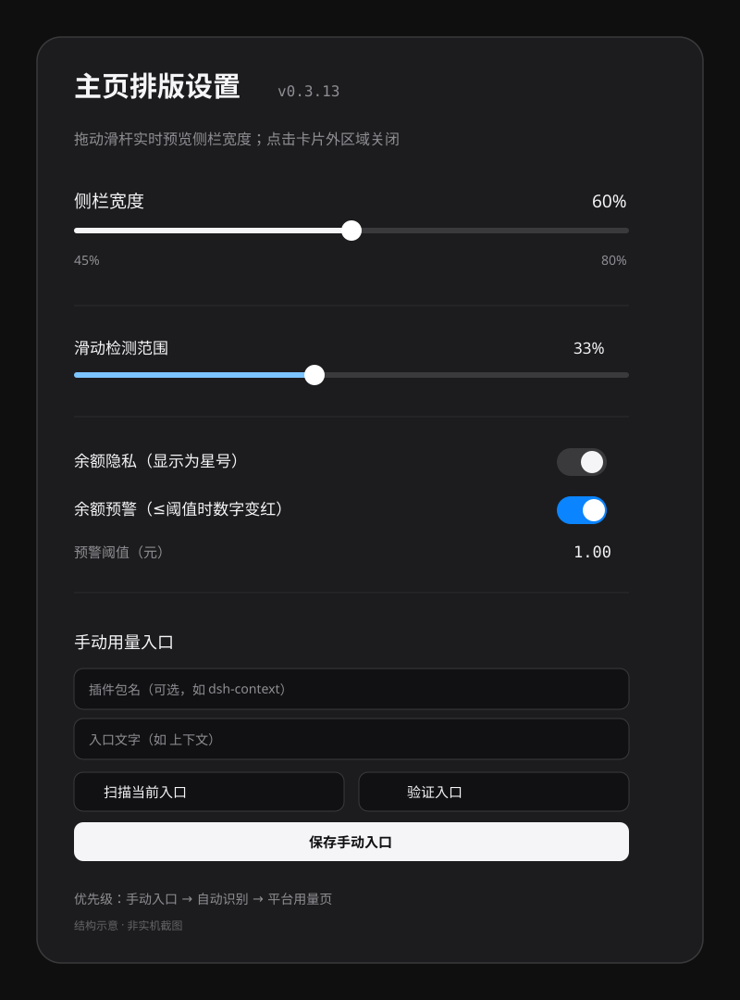

# 侧边栏优化 · dsh-sidebar-optimization

[English](README.md) | **中文**

[](https://github.com/yinfenAce/dsh-sidebar-optimization/actions/workflows/ci.yml)
 · **v0.3.13** · [更新记录](CHANGELOG.md)

面向 [DSHBox](https://github.com/WSK-build/DSHBox) / DeepSeek Harness 的移动端侧边栏优化插件。它是纯客户端插件，不替换内置的 `@local/dsh-mobile-adapt`，只覆盖部分移动端样式并增加交互。

## 截图



*设置卡片结构示意（非实机截图）。实际界面以当前 Release 为准。*

## 功能

- **侧栏宽度可调**：默认 60%，支持 50% / 60% / 70% 预设和 45%–80% 自定义滑杆，设置会记住；
- **左右布局互换**：侧栏可移到右侧，滑动方向同步反转；
- **滑动范围可调**：20%–80%，调整时显示浅蓝范围提示；
- **点击空白关闭**：点击右侧空白区域收起侧栏；
- **自由滚动**：面板、会话列表、底部区域作为一列滚动；
- **长会话性能**：消息使用 `content-visibility: auto`，减少键盘弹起时的重排；
- **键盘跟随**：通过 `visualViewport` 立即调整根高度，减少输入框延迟；
- **☰ 可拖动**：长按拖动，松手吸附到最近一侧，位置会记住；
- **复制修正**：Clipboard API 失败时使用 textarea 兜底，代码块提供“复制”按钮；
- **视图切换动画**：切换对话/轨迹时淡入并轻微上移；
- **余额显示**：可选显示账户余额，保留两位小数；
- **余额隐私**：开启后金额显示为 `****`，右侧出现带斜线的眼睛按钮；点击眼睛显示余额，再点恢复星号；
- **余额预警**：开启后显示阈值设置，默认 ¥1；余额小于等于阈值时数字变红，阈值可自定义（≥0）；
- **用量入口**：优先手动入口，其次自动识别已启用的用量/上下文插件，最后打开官方平台用量页；
- **设置卡片可滚动**：屏幕较矮时内容可滚动，不遮挡操作。

## 安装

从 GitHub 源码安装：

```sh
dsh plugin --profile web add github:yinfenAce/dsh-sidebar-optimization
```

或使用 Release 的固定版本 tarball：

```sh
dsh plugin --profile web add https://github.com/yinfenAce/dsh-sidebar-optimization/releases/download/v0.3.13/dsh-sidebar-optimization-0.3.13.tgz
```

安装后需要**完全退出 DSHBox 再启动**；只刷新页面不会重新加载客户端插件。

## 使用

1. 打开侧栏；
2. 点击“主页排版设置”；
3. 在卡片中调整宽度、滑动范围、余额隐私/预警、手动用量入口；
4. 点击卡片外区域关闭。

手动用量入口的优先级：

```text
手动入口 → 自动识别（已启用插件） → 官方平台用量页
```

## 兼容性

- **DSHBox**：1.4+ / 1.5.x，需启用内置 `@local/dsh-mobile-adapt`；实测 1.5.1；
- **DSH**：声明 `>=0.2.0-rc.2 <0.3.0`，实测 0.2.1-rc.5；
- **Android**：10+，使用系统 WebView；实测 Android 14；
- **视口**：≤ 1024px；桌面布局不做修改。

## 开发

```sh
npm run check
npm test
npm pack --dry-run
```

- [架构说明](docs/ARCHITECTURE.md)
- [开发与发布流程](docs/DEVELOPMENT.md)
- [贡献指南](CONTRIBUTING.md)
- [安全策略](SECURITY.md)

## 安全

- 纯客户端，宿主半为空实现；
- 不读取本地文件、不启动服务、不收集数据；
- 外部跳转仅限官方 DeepSeek 用量/充值页面；
- 手动用量入口只能点击侧栏/顶部导航项，不接受任意 URL；
- 余额通过宿主账户接口读取，不持久化。

## 许可证

MIT，见 [LICENSE](LICENSE)。
